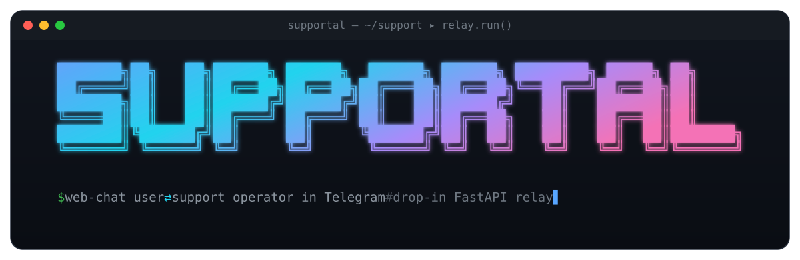
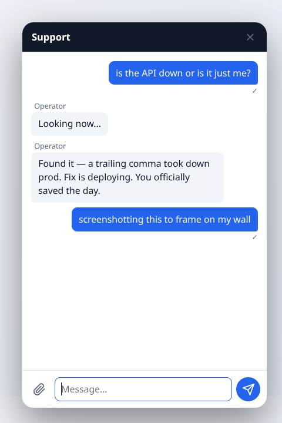
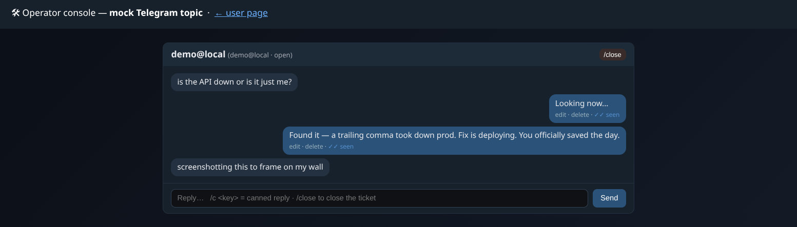

<p align="center">
  <br><br>
  
</p>

<p align="center">
  <b>Embeddable relay: web‑chat user ⇄ support operator in Telegram.</b><br>
  Your users chat from a widget inside your web app. Your team answers from a Telegram group.<br>
  No vendor console, no SaaS, no data leaving your infrastructure — just one small FastAPI service.
</p>

<p align="center">
  <a href="https://github.com/Neanderthal/supportal/actions/workflows/ci.yml"></a>
  <a href="LICENSE"></a>
  <a href="https://www.python.org/"></a>
  
  <a href="https://github.com/astral-sh/ruff"></a>
  
</p>

<p align="center">
  <a href="#-quick-start">Quick start</a> ·
  <a href="#-how-it-works">How it works</a> ·
  <a href="#-http-api">API</a> ·
  <a href="docs/README.md">Docs</a> ·
  <a href="ROADMAP.md">Roadmap</a>
</p>

---

## 👀 See it in action

<p align="center">
  
</p>
<p align="center">
  <sub>⬆&nbsp; your <b>user</b>, in a widget inside your web app &nbsp;·&nbsp; ⬇&nbsp; your <b>operator</b>, answering from a Telegram topic</sub>
</p>
<p align="center">
  
</p>

<p align="center">
  <sub>Everything above is the included offline demo — <code>uv run python examples/demo/demo_server.py</code>. No real bot required.</sub>
</p>

## 💡 Why

Off‑the‑shelf live‑chat tools solve the *inverse* flow — the user writes in Telegram while the
operator sits in a vendor web console (Chatwoot, Jivo, Crisp, …). The **"user in the web, operator in
Telegram"** flow is niche, and that's exactly the gap `supportal` fills:

- 🏠 **Self‑hosted.** Conversations stay in *your* Telegram workspace; nothing is sent to third parties.
- ♻️ **Reuses what you run.** A bot + a supergroup is the whole "agent console" — no new UI to operate.
- 🔌 **Drops into anything.** The relay knows nothing about your product — just an opaque `user_ref`
  and an HTTP contract — so it embeds behind a ~30‑line adapter.

## ✨ Features

| | |
|---|---|
| 🧩 **Product‑agnostic** | The relay only sees an opaque `user_ref` + an HTTP contract. Zero framework coupling. |
| 💬 **Drop‑in widget** | A vanilla JS/CSS bundle (`supportal/widget/`). No React, no build step — one `<script>` + `<link>`. |
| 🎫 **1 topic = 1 ticket** | Each user gets a Telegram forum topic; operators use `/close` `/clear` `/help` `/del`. |
| 🔁 **Live sync** | Operator edits (`edited_message`) and recalls (`/del`) propagate to the widget. The feed is the source of truth and survives reloads. |
| 🔒 **Token‑gated** | The browser talks to the relay with a short‑lived HMAC token your product mints; `user_ref` is resolved server‑side (anti‑spoofing). |
| 📡 **Long‑polling** | Egress‑only to `api.telegram.org` — no public inbound webhook to expose. |
| 📨 **Durable fallback** | Optional "via‑product" callback model with an outbox + backoff retry for offline users. |
| 🌍 **i18n + optional extras** | English/Russian packs; attachments, CSAT, read receipts, business hours, GDPR, `/metrics`, SSE, LLM auto‑answer — all **off by default**, flag‑gated. |
| ✅ **Tested & linted** | Offline unit tests (no network/Telegram needed), ruff‑clean, CI on 3.12 + 3.13. |

## 🏗 How it works

```
   browser user                                      support operator
 ┌───────────────┐                                 ┌──────────────────┐
 │  💬 widget     │  POST /v1/widget/send  (Bearer) │  Telegram forum  │
 │ (supportal/   │ ───────────────────────────────▶│   supergroup     │
 │   widget/)    │  GET  /v1/widget/messages?since= │  1 topic / user  │
 └───────┬───────┘       (poll ~4s, or SSE)         └────────┬─────────┘
         │                                                   │ reply in topic
         ▼                   ┌─────────────┐                 │  edit / /del
      your web app ─────────▶│  supportal  │◀── getUpdates ──┘  (long-polling)
      (reverse proxy)        │  FastAPI    │
                             │  + SQLite   │  writes the `messages` feed = source of truth
                             └─────────────┘
```

Two contours share one relay:

- **Contour A — browser widget (primary).** The browser talks to the relay directly through your reverse
  proxy (same‑origin `/support-api/v1/widget/*`), authorized by a Bearer token. Replies arrive by polling/SSE.
- **Contour B — via product (optional).** Your product posts ingress to `/v1/messages` and receives
  replies via a signed HTTP callback with an outbox/retry fallback. Dormant unless
  `SUPPORT_PRODUCT_CALLBACK_URL` is set.

## 🚀 Quick start

```bash
# 1. run it (uv — https://docs.astral.sh/uv/)
uv sync
cp .env.example .env                 # add bot token, group id, SUPPORT_WIDGET_SECRET
uv run uvicorn supportal.app:app --port 8500
curl localhost:8500/health           # {"status":"ok","service":"supportal"}

# …or with Docker
docker compose up -d                 # service on :8500 (reads .env)
```

**Just want to see it?** The offline demo needs no bot and no secrets:

```bash
uv run python examples/demo/demo_server.py
# open http://localhost:8600          (user page with the widget)
# open http://localhost:8600/operator (mock "Telegram topic" to reply from)
```

## 🔌 HTTP API

Full contract in [`docs/api.md`](docs/api.md). The whole browser side is two calls:

```bash
# send a message (Bearer token minted by your product)
curl -X POST localhost:8500/v1/widget/send \
  -H "Authorization: Bearer $TOKEN" -H "Content-Type: application/json" \
  -d '{"text":"is the API down or is it just me?"}'
# → {"ok": true, "message_id": 42}

# poll for new/edited/deleted messages since a cursor
curl "localhost:8500/v1/widget/messages?since=0" -H "Authorization: Bearer $TOKEN"
# → {"messages":[{"id":42,"direction":"in","text":"…","seq":1}, …], "cursor": 7}
```

- **Contour B** (HMAC `X-Supportal-Signature`): `POST /v1/messages` + a signed callback to your product.
  Runnable reference adapter: [`examples/product_adapter.py`](examples/product_adapter.py).
- `GET /health` → `{"status":"ok","service":"supportal"}`.
- Interactive docs (Swagger `/docs`, ReDoc `/redoc`): set `SUPPORT_OPENAPI=on`.

## ⚙️ Configuration

Secrets and settings come from the environment (`.env`) — full annotated list in [`.env.example`](.env.example).

| Variable | Purpose |
|---|---|
| `SUPPORT_TG_BOT_TOKEN` | support bot token ([@BotFather](https://t.me/BotFather)) |
| `SUPPORT_TG_GROUP_ID` | chat_id of the forum supergroup (bot is admin with "Manage topics") |
| `SUPPORT_WIDGET_SECRET` | **contour A:** shared secret to mint/verify the widget token |
| `SUPPORT_ALLOWED_ORIGIN` | product origin for CORS (empty → same‑origin in prod) |
| `SUPPORT_PRODUCT_CALLBACK_URL` | **contour B:** where to POST operator replies; empty → callback/outbox dormant |
| `SUPPORT_CALLBACK_SECRET` / `SUPPORT_INGRESS_SECRET` | HMAC secrets for the two contour‑B legs |
| `SUPPORT_DB_URL` | storage for tickets + feed + outbox (default `sqlite:///./supportal.db`) |
| `SUPPORT_TG_PROXY` | forward proxy for Telegram egress (useful when it's reachable only over IPv6) |
| `SUPPORT_LOG_LEVEL` | `INFO`/`DEBUG`; only metadata is logged, never message text |

### 🚩 Feature flags

Optional features are **off by default** and gated by a flag — set it in the environment, or live in an
optional **`settings.yaml`** (copy [`settings.yaml.example`](settings.yaml.example)) that the service
re‑reads by mtime, so you can toggle **without a restart**. Priority: `settings.yaml` → env → default.

| Flag | Default | What it does |
|---|---|---|
| `SUPPORT_LOCALE` | `en` | built‑in locale pack for server copy + widget UI (`en`\|`ru`) |
| `SUPPORT_RATE_LIMIT` | off | anti‑spam on `POST /v1/widget/send`, per `user_ref` (sliding window) |
| `SUPPORT_ATTACHMENTS` | off | file attachments both ways (images inline, files as links); bytes in the DB |
| `SUPPORT_VISITOR_CONTEXT` | off | post a one‑time page URL/title + custom fields block into a new topic |
| `SUPPORT_CSAT` | off | after `/close`, a 1..5 star rating in the widget → feed row + posted to the topic |
| `SUPPORT_BUSINESS_HOURS` | off | out‑of‑hours → a one‑time "we're away" auto‑reply (needs `SUPPORT_HOURS`) |
| `SUPPORT_CANNED` | off | operator sends a preset by typing `/c <key>` in the topic |
| `SUPPORT_RECEIPTS` | off | read receipts: 👀 reaction in Telegram + a delivered tick in the widget |
| `SUPPORT_SSE` | off | push feed changes over Server‑Sent Events (lower latency than polling) |
| `SUPPORT_AI` | off | LLM auto‑answer from a small markdown KB before human handoff |
| `SUPPORT_GDPR` | off | `POST /v1/admin/export\|delete {user_ref}` (HMAC) to export or erase a user's data |
| `SUPPORT_METRICS` | off | expose `GET /metrics` (Prometheus text) — internal network only |
| `SUPPORT_OPENAPI` | off | expose Swagger `/docs`, ReDoc `/redoc`, `/openapi.json` (read at startup) |

<sub>Every flag and its tuning knobs are documented in [`.env.example`](.env.example) and
[`settings.yaml.example`](settings.yaml.example).</sub>

## 🤖 Telegram setup (one‑time)

1. Create a bot via [@BotFather](https://t.me/BotFather) → `SUPPORT_TG_BOT_TOKEN`.
2. Create a **supergroup** and enable **Topics** (forum mode).
3. Add the bot as an administrator with the **Manage topics** right.
4. Take the group's `chat_id` (usually negative, `-100…`) → `SUPPORT_TG_GROUP_ID`.

Operators then work right in the group — one topic per user; reply in the topic; `/close` closes the
ticket, `/clear` wipes both sides, `/help` lists commands.

## 🧩 Embedding in your product

Your product does exactly two things (a thin adapter):

1. **Mint a token** for the logged‑in user at `POST /support/config` (identity resolved server‑side) with
   `SUPPORT_WIDGET_SECRET`. The token scheme lives in [`supportal/tokens.py`](supportal/tokens.py).
2. **Vendor the widget bundle** (`supportal/widget/widget.{js,css}`) and expose the relay at same‑origin
   `/support-api/v1/widget/*` through your reverse proxy.

> **i18n:** English by default; set `SUPPORT_LOCALE=ru` for the built‑in Russian pack (server notices +
> widget UI). Products can override individual widget strings via a `strings` map in `/support/config`.

Full guide: [`docs/integration.md`](docs/integration.md).

## 🗄 Storage

SQLite by default (zero infra). For a multi‑user / fault‑tolerant deployment, set
`SUPPORT_DB_URL=postgresql://…` — `app.create_app` selects the reference Postgres backend
([`supportal/store_pg.py`](supportal/store_pg.py), `pip install 'supportal[postgres]'`), same `Store` contract.

> ⚠️ **Run exactly one process.** The Telegram long‑poller, outbox‑retry loop and in‑memory rate limiter
> are per‑process singletons — do **not** run `uvicorn --workers >1` or multiple replicas (two `getUpdates`
> consumers → Telegram **409 Conflict**; double outbox delivery). Scale **up**, not out. Postgres shares the
> *store* only. Details: [`docs/architecture.md`](docs/architecture.md) §Scaling.

## 🛠 Development

```bash
uv sync
uv run ruff check .          # lint
uv run pytest tests/ -q      # offline tests — no network/Telegram needed
```

See [CONTRIBUTING.md](CONTRIBUTING.md) for conventions and the PR workflow.

<details>
<summary>📁 Project layout</summary>

```
supportal/
├── config.py        # env → Config (secrets from env only)
├── models.py        # DTOs — the embedding boundary
├── store.py         # tickets ↔ topic ↔ user + messages feed (SQLite)
├── store_pg.py      # reference Postgres backend (same Store contract)
├── telegram_ops.py  # aiogram: forum topics + long-polling (text/commands/edits)
├── tokens.py        # mint/verify short-lived widget access token (HMAC+exp)
├── relay.py         # orchestration: ingress / operator reply / edit / delete
├── i18n.py          # built-in en/ru locale packs for server-generated copy
├── api.py           # FastAPI router: POST /v1/messages (HMAC) + GET /health
├── widget_api.py    # public widget API: /v1/widget/{send,messages} (Bearer)
├── widget/          # embeddable UI bundle: widget.js + widget.css (vanilla)
└── app.py           # app assembly + lifespan (long-polling) + CORS
tests/               # offline unit tests (contract / store / HMAC / widget)
examples/demo/       # the runnable offline demo you saw above
docs/                # detailed design docs
```
</details>

## 🔐 Security

Report vulnerabilities privately — see [SECURITY.md](SECURITY.md). The relay handles arbitrary user text
and bot credentials: keep secrets in the environment only, and log metadata, not message content.

## 🗺 Roadmap

Planned work is tracked in [ROADMAP.md](ROADMAP.md). The relay stays a thin, product‑agnostic component —
the operator experience lives in Telegram by design.

## 🤝 Contributing

Issues and PRs welcome — start with [CONTRIBUTING.md](CONTRIBUTING.md) and the
[Code of Conduct](CODE_OF_CONDUCT.md).

## 📄 License

[MIT](LICENSE) © 2026 Sergey Istomin
